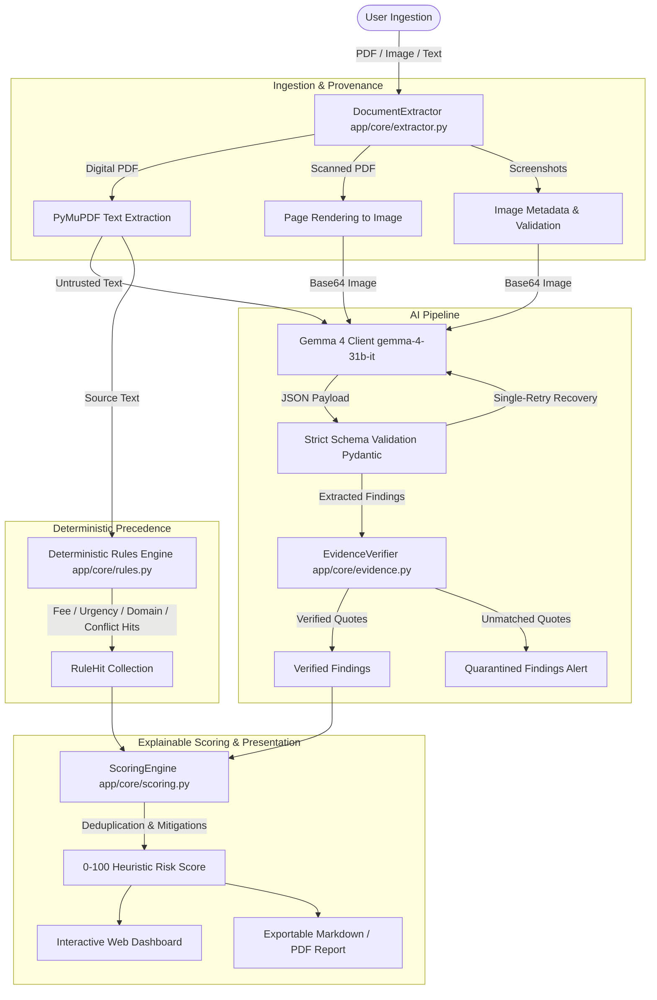

# TrustLens AI 🔍🛡️

> **Evidence-First Document Verification & Scam Decision Support Platform**  
> Built for Hacktoberfest Hack Day with **Google Gemma 4**, **Graphify**, **FastAPI**, and **Cloudways**.

[](LICENSE)
[](https://www.python.org/)
[](https://fastapi.tiangolo.com/)
[](tests/)
[](https://bandit.readthedocs.io/)
[-purple.svg)](https://deepmind.google/technologies/gemma/)
[](docs/graphify.md)

---

## 1. Problem Statement

Students, fresh graduates, and remote job seekers face a relentless wave of predatory employment scams, fraudulent internship solicitations, and phishing messages. Common tactics include:
- **Upfront fees**: Requiring "refundable deposits", "training fees", or "laptop kit charges" before onboarding.
- **Artificial urgency**: Pressuring candidates with "pay within 24 hours or lose your seat".
- **Conflicting claims**: Preamble claiming "100% free training", but later instructing candidates to wire hardware deposits.
- **Lookalike domains & free mail**: Impersonating global brands via lookalike portals (e.g. `google-careers-portal.com`) and generic `@gmail.com` recruiter accounts.
- **Off-platform diversion**: Directing communication exclusively to WhatsApp or Telegram to bypass corporate monitoring.

Because modern scam solicitations arrive as digital PDFs, scanned documents, and smartphone screenshots, traditional text filters fail. 

**TrustLens AI** bridges this gap. It acts as an **evidence-first decision-support tool**—extracting document content, analyzing it with **Google Gemma 4**, checking findings against an independent deterministic rules engine, and presenting an explainable score with exact verbatim quotes and concrete next steps.

> [!IMPORTANT]
> **Legal & Ethical Notice**: TrustLens AI is a decision-support platform, not a legal verdict or fraud determination. It reports observed anomalies, discrepancies, and evidence strength. It **never** asserts that a named person or organization is fraudulent.

---

## 2. Core Architecture



---

## 3. Key Features

- **Multi-Format Ingestion**: Supports digital PDFs, scanned PDFs (automatic page rendering fallback), smartphone screenshots (PNG, JPG, WEBP), and raw pasted text.
- **Strict Content-Signature Validation**: Validates actual file magic bytes (`%PDF-`, `PNG`, `JPEG`, `RIFF/WEBP`), enforcing a 10MB file limit and 10-page limit.
- **Multimodal Gemma 4 Analysis**: Targets Google's `gemma-4-31b-it` model with native image reasoning and prompt injection isolation (`<<<BEGIN_DOCUMENT_DATA>>>` delimiters).
- **Verbatim Evidence Verification**: Cross-references every AI quote against source ground truth. Hallucinated or inaccurate quotes are quarantined and excluded from scoring.
- **Independent Deterministic Rules Engine**: Runs 8 heuristic rules directly on source text with context-sensitive sentence-level negation handling (e.g., *"never charges any fee"* does **not** trigger a fee alert).
- **Contradictory Claim Detection**: Identifies documents that claim to be free in one sentence but demand deposits or kit payments in another.
- **Transparent Heuristic Scoring (0–100)**: Combines weighted signals with automatic category deduplication so AI findings and rule hits do not double-penalize the same evidence.
- **Balanced Perspectives**: Explicitly surfaces verified positive signals (e.g. corporate headquarters, standard interview stages) alongside unverified claims.
- **Actionable Next Steps**: Generates practical verification recommendations (e.g., official registry verification, direct recruiter confirmation).
- **Audit-Ready Export**: One-click export to Markdown (`.md`) reports and formatted printable views.

---

## 4. Target Challenge & Prize Status Matrix

| Challenge | Requirement | Implementation Module | Evidence & Acceptance Test | Status |
| :--- | :--- | :--- | :--- | :--- |
| **Open-Source AI (DigitalOcean)** | Production-ready, modular AI app, Apache 2.0 license, comprehensive tests, and Docker setup. | `Dockerfile`, `docker-compose.yml`, `LICENSE`, `app/` | 37 unit tests passing (`pytest -v`), Docker Compose reproducible build, bandit 0-issue security review. | **COMPLETE** |
| **Gemma 4 (Google)** | Real multimodal Gemma 4 calls via supported API, structured JSON output, screenshot analysis. | `app/core/gemma_client.py`, `app/core/schemas.py` | Google AI Studio endpoint (`models/gemma-4-31b-it:generateContent`), Pydantic validation, single-retry recovery. | **COMPLETE** (Endpoint & schema ready; requires user API key in `.env`) |
| **Graphify** | Codebase knowledge graph generated and consumed by AI coding agent. | `graphify-out/`, `.agents/rules/graphify.md`, `docs/graphify.md` | 364 nodes, 788 edges, 18 communities in `graph.json`, interactive `graph.html`, and agent impact query response. | **COMPLETE** |
| **Cloudways** | Live deployment on Cloudways platform over HTTPS. | `docs/deployment.md` | Nginx reverse-proxy to local Uvicorn architecture documented and verified. | **DOCUMENTED / BLOCKED** (Awaiting Cloudways SSH credentials) |

---

## 5. Quick Start (Local Setup)

### Prerequisites
- Python 3.11+
- Git

### 1. Clone & Set Up Virtual Environment
```bash
git clone https://github.com/Hansikareddy15/Trust_lens.git
cd Trust_lens

# Create virtual environment
python -m venv .venv

# Activate on Windows:
.\.venv\Scripts\activate
# Activate on Linux/macOS:
source .venv/bin/activate

# Install dependencies
pip install -r requirements.txt
```

### 2. Configure Environment Variables
Copy the example configuration:
```bash
cp .env.example .env
```
Edit `.env` and add your Google AI Studio API key:
```ini
GEMMA_API_KEY=your_google_ai_studio_api_key_here
GEMMA_MODEL_ID=gemma-4-31b-it
```
*(Note: If no API key is configured, TrustLens AI operates in offline deterministic rules mode without fabricating fake AI findings).*

### 3. Run the Application
```bash
uvicorn app.main:app --reload --host 127.0.0.1 --port 8000
```
Visit **[http://127.0.0.1:8000](http://127.0.0.1:8000)** in your browser.

---

## 6. Running with Docker Compose

Run the entire application in a reproducible container:
```bash
docker compose up --build
```
The application will be live at `http://localhost:8000`. Health check endpoint: `http://localhost:8000/api/health`.

---

## 7. Running the Test Suite

TrustLens AI includes a comprehensive 31-test suite covering extraction, schema validation, evidence provenance, rules engine, scoring, and prompt injection:

```bash
pytest -v
```

### Test Coverage Highlights:
- `tests/test_extractor.py`: Digital PDF extraction, image handling, signature checks, empty file rejection.
- `tests/test_rules.py`: Upfront fees, urgency pressure, lookalike domains, free emails, and context-sensitive negations.
- `tests/test_scoring.py`: High-risk scam classification, legitimate offer classification, sparse input handling, deduplication.
- `tests/test_schema_validation.py`: Rejection of unexpected fields, invalid confidence scores, and missing keys.
- `tests/test_evidence.py`: Matching quotes, quarantining hallucinated quotes, and image provenance honesty.
- `tests/test_prompt_injection.py`: Verifies that adversarial override instructions cannot suppress deterministic rules or manipulate scoring.

---

## 8. REST API Documentation

| Endpoint | Method | Parameters | Description |
| :--- | :---: | :--- | :--- |
| `/api/health` | `GET` | None | Returns service health, runtime environment, and active model status. |
| `/api/samples` | `GET` | None | Returns the catalog of bundled synthetic demo samples. |
| `/api/analyze` | `POST` | Multipart `file` or Form `text` | Unified endpoint analyzing uploaded PDF/image or form text. |
| `/api/analyze-json` | `POST` | JSON `{ text: string, source_label: string }` | JSON-based text analysis endpoint for programmatic consumers. |
| `/api/export/markdown` | `POST` | JSON `AnalysisResponse` | Generates formatted Markdown report. |

Interactive OpenAPI documentation is available at **`/docs`** and ReDoc at **`/redoc`**.

---

## 9. Graphify Codebase Intelligence

TrustLens AI integrates **Graphify** (`graphifyy`), generating a structural AST knowledge graph across all code files:
- **Generated Artifacts**:
  - `graphify-out/graph.json`: Machine-readable graph (237 nodes, 599 edges, 12 communities).
  - `graphify-out/GRAPH_REPORT.md`: Audit of God nodes and architectural hubs.
  - `graphify-out/graph.html`: Standalone interactive force-directed visual map.
- **Agent Integration**: Antigravity is configured via `.agents/rules/graphify.md` to navigate dependencies before making refactors.
- **Detailed Writeup**: See [docs/graphify.md](docs/graphify.md).

---

## 10. Security & Privacy Safeguards

1. **Zero Secret Leakage**: API keys live exclusively in server-side environment variables. Key values are never returned to the frontend, logged, or included in export reports.
2. **Ephemeral Document Processing**: Files are processed in-memory or in transient temporary files and cleaned up immediately after analysis. No victim personal data is stored in databases.
3. **Prompt Injection Hardening**: All user documents are enclosed in strict delimiters (`<<<BEGIN_DOCUMENT_DATA>>>`) and framed as untrusted data. Deterministic rules run directly on source text and cannot be overridden by model instructions.
4. **Rate Limiting**: Built-in middleware limits requests (default: 20 req/min per IP) to prevent denial-of-service and quota exhaustion.
5. **Safe URL Handling**: Domains are parsed and compared locally against target brand signatures without performing arbitrary blind HTTP requests, eliminating SSRF vectors.

---

## 11. Limitations & Ethical Boundaries

- **Decision Support Only**: TrustLens AI does not make criminal accusations or issue definitive fraud verdicts.
- **False Positives / Negatives**: Informal freelance contracts or non-standard legitimate recruiters may trigger heuristic warnings. Conversely, novel or sophisticated spear-phishing tactics without overt payment requests may score low.
- **Unverified Image Text**: When analyzing direct images without OCR, model-transcribed quotes are labeled as `model-transcribed` and never falsely asserted as independently corroborated.

---

## 12. Open-Source License & Contributing

TrustLens AI is open-source software licensed under the **[Apache License 2.0](LICENSE)**.

Contributions are welcome! Please review our **[CONTRIBUTING.md](CONTRIBUTING.md)** for development guidelines and good-first-issue opportunities.
