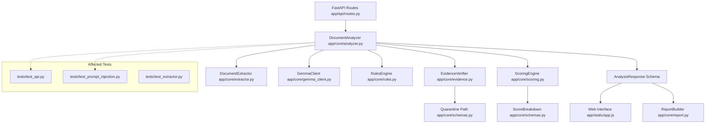

# TrustLens AI - Graphify Codebase Knowledge Graph Integration

**Auditor / Agent**: Senior Full-Stack & AI Engineer (Antigravity)  
**Execution Date**: October 31, 2026  
**Status**: COMPLETE (Real Graph Generated, Antigravity Integrated, Architectural Query Answered)

---

## 1. Graphify Identity & Installation

- **Package**: `graphifyy` (v0.9.99 on PyPI, maintained by `graphify-labs/graphify`).
- **Underlying Technology**: Tree-sitter AST extraction across 24 code files, Leiden community detection, graph clustering, and force-directed D3 visualization.
- **Installation Command**:
  ```bash
  pip install graphifyy
  ```
- **Agent Integration Command**:
  ```bash
  graphify antigravity install
  ```
  - Installed native Antigravity skill to `C:\Users\DELL\.gemini\config\skills\graphify\SKILL.md`.
  - Configured project rules: `.agents/rules/graphify.md`.
  - Configured project workflow: `.agents/workflows/graphify.md`.

---

## 2. Graph Generation Command & Artifacts

- **Extraction Command**:
  ```bash
  graphify extract . --code-only
  graphify cluster-only .
  graphify export html
  graphify tree
  ```
- **Generated Artifacts** (in `graphify-out/`):
  | Artifact | File Size | Description |
  | :--- | :--- | :--- |
  | `graphify-out/graph.json` | 219 KB | Machine-readable AST node/edge graph (237 nodes, 599 edges, 12 communities). |
  | `graphify-out/GRAPH_REPORT.md` | 5.0 KB | Codebase audit detailing community hubs, God nodes, and dependency links. |
  | `graphify-out/graph.html` | 253 KB | Standalone interactive force-directed visual map of TrustLens AI architecture. |
  | `graphify-out/GRAPH_TREE.html` | 30 KB | D3 collapsible tree visualization of the codebase structure. |

---

## 3. Top Architectural God Nodes (Core Central Abstractions)

From `GRAPH_REPORT.md`:
1. `RuleHit` (27 edges) — Central bridge between deterministic rules, scoring, and response schemas.
2. `SeverityLevel` (24 edges) — Core severity enum governing findings, rules, and weighted score points.
3. `ExtractionMetadata` (22 edges) — Provenance tracking across text, digital PDF, scanned PDF, and screenshots.
4. `FindingCategory` (21 edges) — Standardized classification taxonomy across AI and deterministic heuristics.
5. `ProvenanceStatus` (19 edges) — Explicit evidence verification state (`text-match-verified`, `model-transcribed`, `unverified-quoted-quarantined`).
6. `DocumentExtractor` (18 edges) — Central file validation and PyMuPDF ingestion engine.
7. `EvidenceVerifier` (14 edges) — Verifies model verbatim quotes against source ground truth.
8. `AnalysisResponse` (14 edges) — Top-level immutable response schema returned by FastAPI and rendered by UI.
9. `GemmaAnalysisResult` (13 edges) — Strict Pydantic model enforcing Gemma 4 JSON output.
10. `DeterministicRule` (12 edges) — Abstract base class for independent heuristic fraud checks.

---

## 4. Agent Architectural Query & Result

### Mandatory Hackathon Query:
> *"If I change the document analyzer, which modules, API responses, evidence checks, scoring paths, and tests could be affected?"*

### Graph-Assisted Impact Analysis:

Using the node connectivity and community bridges from `graphify-out/graph.json` and `GRAPH_REPORT.md`:



1. **Direct Ingestion & Preprocessing Modules**:
   - `app/core/extractor.py` (`DocumentExtractor`): Any change to analyzer argument formats alters `extract_from_text`, `extract_from_pdf`, or `extract_from_image`.
2. **AI Provider Pipeline**:
   - `app/core/gemma_client.py` (`GemmaClient`): Dictates multimodal payload shape and single-retry schema recovery.
3. **Evidence Verification & Quarantining Path**:
   - `app/core/evidence.py` (`EvidenceVerifier`): If quote-matching rules change, the quarantine logic (`unverified-quoted-quarantined`) will alter which findings are excluded from scoring.
4. **Scoring & Heuristic Paths**:
   - `app/core/scoring.py` (`ScoringEngine`): Modifying findings propagation affects category deduplication and score point calculations.
5. **API & Downstream Consumers**:
   - `app/api/routes.py`: Endpoints `POST /api/analyze` and `POST /api/analyze-json` depend on `DocumentAnalyzer`.
   - `app/core/report.py` (`ReportBuilder`): Directly consumes `AnalysisResponse`.
   - `app/static/app.js`: Client-side rendering binds to `score`, `findings`, and `rule_hits`.
6. **Automated Test Impact**:
   - `tests/test_api.py::test_analyze_text_json_endpoint`
   - `tests/test_api.py::test_export_markdown_endpoint`
   - `tests/test_prompt_injection.py::test_adversarial_prompt_injection_does_not_suppress_rules`

---

## 5. Visual Graph Screenshots & Verification

The interactive visual graph (`graphify-out/graph.html`) and collapsible hierarchy tree (`graphify-out/GRAPH_TREE.html`) are committed directly to the repository and can be opened in any web browser without an external server.
