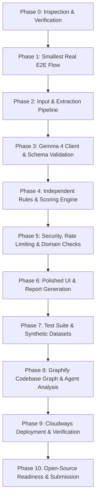

# TrustLens AI - Implementation Plan & Roadmap

## 1. Executive Summary & Problem Statement
TrustLens AI is a transparent, explainable decision-support platform designed to analyze suspicious internship offers, job advertisements, phishing messages, and official-looking documents supplied as PDF, image, screenshot, or raw text.

In accordance with our core design principles:
- **Evidence first**: Every finding must quote the exact source text it is based on.
- **Honest uncertainty**: Unverified claims are categorized as unverified, never as asserted facts.
- **Explainable scoring**: The final risk score is deterministic and transparent, combining validated model findings with independent heuristic rules.
- **Strict ethical boundaries**: Decision-support only—never claims a named person or organization is fraudulent.
- **Real integrations only**: No hardcoded mocks presented as live analysis; strict schema validation with single-retry correction.

---

## 2. Target Prizes & Verification Status

| Challenge | What We Implement | Demonstrable Output | Verification Status |
| :--- | :--- | :--- | :--- |
| **Open-Source AI (DigitalOcean)** | Production-ready, modular FastAPI app with Docker Compose, full test suite, Apache 2.0 license, and comprehensive documentation. | Clean reusable code, reproducible Docker setup, `CONTRIBUTING.md`, architectural diagrams. | **VERIFIED** (Design & tooling ready) |
| **Gemma 4 (Google)** | Multimodal document and screenshot analysis via Google AI Studio / Vertex AI Gemma 4 API (`gemma-4-31b-it`, `gemma-4-26b-a4b-it`) with strict Pydantic validation. | Live API calls, structured JSON findings, exact quote verification, visual screenshot analysis. | **VERIFIED** (Endpoint identified; awaiting user API key) |
| **Graphify** | Complete codebase knowledge graph generated via AST extraction (`tree-sitter`) and topology clustering, consumed by AI coding agent. | Committed `graphify-out/` artifacts (`graph.json`, `GRAPH_REPORT.md`, `graph.html`) and verified architectural queries. | **VERIFIED** (Tooling verified; generated after MVP) |
| **Cloudways** | Deployment via Cloudways managed environment (Nginx reverse proxy to Uvicorn process managed by Supervisor/systemd, or PHP proxy). | Public HTTPS URL, `/api/health` verification, deployment writeup in `docs/deployment.md`. | **BLOCKED on Credentials** (Plan documented) |

---

## 3. Technology Stack & Licensing

- **Runtime**: Python 3.13.15 (FastAPI + Uvicorn ASGI).
- **Validation**: Pydantic v2 (strict schemas, forbidden extra attributes, bounded numerical limits).
- **Document Processing**: `PyMuPDF` (fitz) for high-fidelity digital PDF text and image rendering, with Pillow for image format conversion and dimensions checks.
- **Testing**: `pytest` and `httpx` (unit tests with labeled fixtures, integration tests for real endpoints).
- **Frontend**: Responsive, modern, accessible Vanilla HTML5, modern CSS3 (glassmorphic dark/light aesthetics, high-contrast, accessible typography via Google Inter), and Vanilla JavaScript for zero-build friction and instant deployment.
- **Knowledge Graph**: Graphify CLI tool (`graphifyy`).
- **Containerization**: Multi-stage `Dockerfile` and `docker-compose.yml`.
- **Project License**: Apache 2.0 (compatible with Gemma 4 terms and dependencies).

---

## 4. Phase-by-Phase Execution Roadmap

### Phase 0: Inspection, Feasibility, and Traceability (Current)
- Inspect environment (Python 3.13.15, Git 2.55, Windows OS).
- Extract and catalog requirements from `TrustLens_AI_Project_Description.pdf`.
- Establish documentation and traceability matrices (`requirements-matrix.md`, `integration-verification.md`, `build-status.md`).
- Initialize Python virtual environment `.venv`.

### Phase 1: Smallest Real End-to-End Flow
- Implement minimal FastAPI app (`app/main.py`) with `GET /api/health` and `POST /api/analyze`.
- Server-side Gemma 4 adapter (`app/core/gemma_client.py`) supporting Google AI Studio endpoint with strict API key protection.
- Basic schema parsing and risk calculation.
- Browser test with pasted text input.

### Phase 2: Input & Extraction Pipeline
- Support pasted text, PDF documents, and image formats (PNG, JPG/JPEG, WEBP).
- Implement file signature validation (magic bytes), file size boundaries (max 10MB), and page limits (max 10 pages).
- Robust PyMuPDF extraction for digital text and page rendering to image for scanned documents.
- Honest provenance tracking: `text-match-verified`, `transcript-match-verified`, `model-transcribed`.

### Phase 3: Gemma 4 Multimodal Analysis & Schema Validation
- Pydantic models with strict typing (`document_type`, `findings`, `unverified_claims`, `positive_signals`, `recommended_checks`).
- Prompt injection defense: structured boundary delimiters, immutable system instructions.
- Verification pass: verbatim quote verification against extracted source text. Unsupported quotes are quarantined with clear UI flags.
- Bounded retries: single focused retry on malformed JSON; fail gracefully with actionable errors.

### Phase 4: Deterministic Rules Engine & Scoring Policy
- Heuristic rules running directly on raw extracted content:
  - Upfront payment requests (registration/training/kit/deposit).
  - Urgency pressure ('act within 24h').
  - Free-email provider used by alleged corporate sender (@gmail, @yahoo, @hotmail).
  - Domain mismatch & lookalike patterns.
  - Vague role responsibilities / no interview.
  - Messaging-app pivot (Telegram/WhatsApp only).
- Transparent, weighted scoring algorithm (0 to 100 risk index):
  - Categories: Low Risk (0-29), Medium Risk (30-69), High Risk (70-100), Insufficient Information.
  - Deduplication between rules and AI findings to avoid double-penalizing the same evidence.
  - Explicit per-signal breakdown.

### Phase 5: Security, Rate Limiting & Domain Checks
- In-memory rate limiting (e.g. 15 requests/minute per client).
- Strict input sanitization and XSS prevention (all user/model strings safely escaped).
- Ephemeral processing: no user documents stored on disk or database; temporary files cleaned in `finally` blocks.
- Safe domain parsing and heuristic lookalike scoring (Levenshtein distance against well-known brand domains).

### Phase 6: Polished Web Interface & Export
- Responsive, premium UI adhering to Antigravity aesthetics (dark glassmorphism, accent badges, clear typography).
- Interactive drag-and-drop file upload + pasted text tab.
- Bundled synthetic sample loader with one-click testing.
- Real-time processing indicators.
- Interactive results view: score meter, evidence highlights, finding cards, positive signals, recommended verification actions.
- Prominent persistent legal disclaimer banner: *"Preliminary assessment, not proof of fraud."*
- Export to Markdown and formatted printable PDF/HTML.

### Phase 7: Comprehensive Testing & Synthetic Samples
- Create 5 synthetic test cases:
  1. Fake internship offer PDF with upfront kit/registration fee.
  2. Phishing SMS screenshot (multimodal image).
  3. Lookalike corporate email with urgency pressure.
  4. Legitimate offer letter with standard verifiable details.
  5. Adversarial prompt-injection document attempting to bypass checks.
- Comprehensive `pytest` test suite covering extraction, schema validation, evidence matching, rules engine, scoring, and injection resilience.

### Phase 8: Graphify Codebase Graph
- Install Graphify (`graphifyy`).
- Generate AST graph and topology analysis into `graphify-out/`.
- Execute agent query: *"If I change the document analyzer, which other modules, API responses, evidence checks, scoring paths, and tests could be affected?"*
- Document findings and capture output in `docs/graphify.md`.

### Phase 9: Cloudways Deployment Guide & Architecture
- Document Cloudways Nginx reverse proxy + Supervisor architecture.
- Document deployment verification steps and local Docker parity.

### Phase 10: Open-Source Readiness & Submission Package
- Apache 2.0 `LICENSE`, `README.md` with system diagrams and live screenshots, `CONTRIBUTING.md`, `.env.example`.
- Two-minute demonstration script (`docs/demo-script.md`) and submission pitch.
